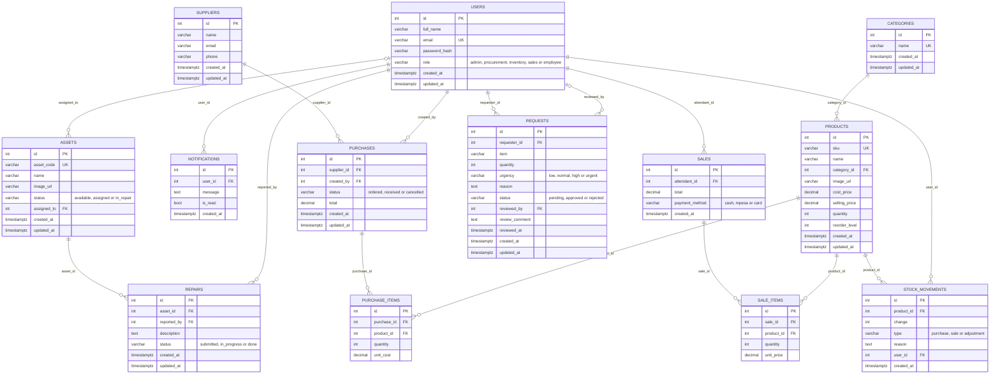

# StockPilot — Database design (ERD)

PostgreSQL · 13 tables · generated from the SQLAlchemy models in `backend/app/models/`, so it
matches the real database. An image version is in [erd.png](erd.png).

## Entity relationship diagram

PK primary key · FK foreign key · UK unique. `||--o{` = one to many; `|o--o{` = optional one
to many (the link column may be empty).

## Key rules the database enforces

| Rule | How |
|---|---|
| Stock can never go below zero | `CHECK (quantity >= 0)` on `products` |
| No two products share a SKU, no two users share an email, no two assets share a code | `UNIQUE` constraints |
| Money is exact | `decimal(12,2)`, never floating point |
| Only allowed values in status/role columns | `CHECK (... IN (...))` on every status, role, urgency and type column |
| History is kept | Foreign keys are `ON DELETE RESTRICT`: a product with sales, or a user with requests, cannot be deleted |
| Passwords are safe | Only Bcrypt hashes are stored |

## Roles (proxy models)

One `users` table; the `role` column decides which Python class a row loads as:

| role | Class | May do |
|---|---|---|
| `admin` | `Admin` | Manage users and roles, products, categories, suppliers, assets. Cannot approve requests. |
| `procurement` | `ProcurementManager` | Approve or reject requests (never their own); manage suppliers. |
| `inventory` | `InventoryManager` | Manage products, categories and assets. |
| `sales` | `SalesAttendant` | Sales (later sprint); view products. |
| `employee` | `Employee` | Make requests; see own requests and assets. Default for new accounts. |

## Data dictionary

### categories

Groups of products (Beverages, Packaging…).

| Column | Type | Required | Keys | Notes |
|---|---|---|---|---|
| `id` | int | yes | PK |  |
| `name` | varchar(100) | yes | UK |  |
| `created_at` | timestamptz | yes |  | Default `now()`. |
| `updated_at` | timestamptz | yes |  | Default `now()`. |

### suppliers

Companies the business buys from.

| Column | Type | Required | Keys | Notes |
|---|---|---|---|---|
| `id` | int | yes | PK |  |
| `name` | varchar(150) | yes |  |  |
| `email` | varchar(255) | no |  |  |
| `phone` | varchar(30) | no |  |  |
| `created_at` | timestamptz | yes |  | Default `now()`. |
| `updated_at` | timestamptz | yes |  | Default `now()`. |

### users

Everyone who signs in. One table for all five roles (the role column picks the Python class: proxy models).

| Column | Type | Required | Keys | Notes |
|---|---|---|---|---|
| `id` | int | yes | PK |  |
| `full_name` | varchar(120) | yes |  |  |
| `email` | varchar(255) | yes | UK |  |
| `password_hash` | varchar(255) | yes |  | Bcrypt hash. The password itself is never stored. |
| `role` | varchar(20) | yes |  | admin, procurement, inventory, sales or employee. New sign-ups are always employee. |
| `created_at` | timestamptz | yes |  | Default `now()`. |
| `updated_at` | timestamptz | yes |  | Default `now()`. |

### assets

Equipment the business owns (laptops, chairs…) and who holds it.

| Column | Type | Required | Keys | Notes |
|---|---|---|---|---|
| `id` | int | yes | PK |  |
| `asset_code` | varchar(30) | yes | UK | Unique code, also printed as the barcode. |
| `name` | varchar(150) | yes |  |  |
| `image_url` | varchar(500) | no |  |  |
| `status` | varchar(12) | yes |  | available, assigned or in_repair. Default `available`. |
| `assigned_to` | int | no | FK | → `users.id`. Who holds the asset; empty when it is available. |
| `created_at` | timestamptz | yes |  | Default `now()`. |
| `updated_at` | timestamptz | yes |  | Default `now()`. |

### notifications

In-app messages for a user.

| Column | Type | Required | Keys | Notes |
|---|---|---|---|---|
| `id` | int | yes | PK |  |
| `user_id` | int | yes | FK | → `users.id`. |
| `message` | text | yes |  |  |
| `is_read` | bool | yes |  | Default `false`. |
| `created_at` | timestamptz | yes |  | Default `now()`. |

### products

What the business sells, with prices and the current stock count.

| Column | Type | Required | Keys | Notes |
|---|---|---|---|---|
| `id` | int | yes | PK |  |
| `sku` | varchar(40) | yes | UK |  |
| `name` | varchar(150) | yes |  |  |
| `category_id` | int | yes | FK | → `categories.id`. |
| `image_url` | varchar(500) | no |  | Cloudinary address of the product photo. |
| `cost_price` | decimal(12,2) | yes |  |  |
| `selling_price` | decimal(12,2) | yes |  |  |
| `quantity` | int | yes |  | Current stock. The database refuses anything below 0. Default `0`. |
| `reorder_level` | int | yes |  | At or below this, the product counts as low stock. Default `0`. |
| `created_at` | timestamptz | yes |  | Default `now()`. |
| `updated_at` | timestamptz | yes |  | Default `now()`. |

### purchases

An order placed with a supplier.

| Column | Type | Required | Keys | Notes |
|---|---|---|---|---|
| `id` | int | yes | PK |  |
| `supplier_id` | int | yes | FK | → `suppliers.id`. |
| `created_by` | int | yes | FK | → `users.id`. |
| `status` | varchar(10) | yes |  | ordered, received or cancelled. Default `ordered`. |
| `total` | decimal(12,2) | yes |  | Default `0`. |
| `created_at` | timestamptz | yes |  | Default `now()`. |
| `updated_at` | timestamptz | yes |  | Default `now()`. |

### requests

An employee asks for something; a Procurement Manager approves or rejects it.

| Column | Type | Required | Keys | Notes |
|---|---|---|---|---|
| `id` | int | yes | PK |  |
| `requester_id` | int | yes | FK | → `users.id`. |
| `item` | varchar(200) | yes |  |  |
| `quantity` | int | yes |  |  |
| `urgency` | varchar(10) | yes |  | low, normal, high or urgent. Default `normal`. |
| `reason` | text | yes |  |  |
| `status` | varchar(10) | yes |  | pending, approved or rejected. Default `pending`. |
| `reviewed_by` | int | no | FK | → `users.id`. The Procurement Manager who decided. Never the requester. |
| `review_comment` | text | no |  |  |
| `reviewed_at` | timestamptz | no |  |  |
| `created_at` | timestamptz | yes |  | Default `now()`. |
| `updated_at` | timestamptz | yes |  | Default `now()`. |

### sales

One completed sale (one receipt).

| Column | Type | Required | Keys | Notes |
|---|---|---|---|---|
| `id` | int | yes | PK |  |
| `attendant_id` | int | yes | FK | → `users.id`. |
| `total` | decimal(12,2) | yes |  |  |
| `payment_method` | varchar(10) | yes |  | cash, mpesa or card. |
| `created_at` | timestamptz | yes |  | Default `now()`. |

### purchase_items

One product line on a purchase order.

| Column | Type | Required | Keys | Notes |
|---|---|---|---|---|
| `id` | int | yes | PK |  |
| `purchase_id` | int | yes | FK | → `purchases.id`. |
| `product_id` | int | yes | FK | → `products.id`. |
| `quantity` | int | yes |  |  |
| `unit_cost` | decimal(12,2) | yes |  |  |

### repairs

A repair report for an asset.

| Column | Type | Required | Keys | Notes |
|---|---|---|---|---|
| `id` | int | yes | PK |  |
| `asset_id` | int | yes | FK | → `assets.id`. |
| `reported_by` | int | yes | FK | → `users.id`. |
| `description` | text | yes |  |  |
| `status` | varchar(12) | yes |  | submitted, in_progress or done. Default `submitted`. |
| `created_at` | timestamptz | yes |  | Default `now()`. |
| `updated_at` | timestamptz | yes |  | Default `now()`. |

### sale_items

One product line on a sale.

| Column | Type | Required | Keys | Notes |
|---|---|---|---|---|
| `id` | int | yes | PK |  |
| `sale_id` | int | yes | FK | → `sales.id`. |
| `product_id` | int | yes | FK | → `products.id`. |
| `quantity` | int | yes |  |  |
| `unit_price` | decimal(12,2) | yes |  | Copied from the product at the moment of sale, so old receipts never change. |

### stock_movements

Every change to a product's stock, so any count can be explained.

| Column | Type | Required | Keys | Notes |
|---|---|---|---|---|
| `id` | int | yes | PK |  |
| `product_id` | int | yes | FK | → `products.id`. |
| `change` | int | yes |  | +10 for stock in, -2 for stock out. Never 0. |
| `type` | varchar(12) | yes |  | purchase, sale or adjustment. |
| `reason` | text | no |  |  |
| `user_id` | int | yes | FK | → `users.id`. |
| `created_at` | timestamptz | yes |  | Default `now()`. |
