# Database design

PostgreSQL, 27 tables. The diagram and the data dictionary below are generated from the
SQLAlchemy models in `backend/app/models/`, and CI runs `flask db check` to prove the migrations
build exactly this schema. [erddoc.png](erddoc.png) shows the original single-business design.

## Many businesses, one database

`businesses` is the tenant table. Every other business table has a `business_id` column
(`ON DELETE CASCADE`), and `backend/app/tenancy.py` adds `WHERE business_id = <the signed-in
user's business>` to every query, join, count, update and delete. Uniqueness is per business: two
shops can both have SKU `SP-001`, receipt `S-0001` and asset `AST-0001`. A user (email address)
belongs to exactly one business.

Document numbers (`S-0001`, `PO-0001`, `GRN-0001`, `REQ-0001`, `REP-001`, `ADJ-0001`, `SUP-001`,
`AST-0001`) come from `document_counters`: one row per business and kind, incremented with a
single atomic `INSERT … ON CONFLICT DO UPDATE … RETURNING`.

## Entity relationship diagram

PK primary key · FK foreign key · UK unique (within a business). `||--o{` is one to many and
`|o--o{` is optional one to many. Every table's link to `businesses` is drawn as well.

```mermaid
erDiagram
    ASSETS ||--o{ ASSET_ASSIGNMENTS : "asset_id"
    ASSETS ||--o{ REPAIRS : "asset_id"
    ASSET_CATEGORIES |o--o{ ASSETS : "category_id"
    BUSINESSES ||--o{ ASSETS : "business_id"
    BUSINESSES ||--o{ ASSET_ASSIGNMENTS : "business_id"
    BUSINESSES ||--o{ ASSET_CATEGORIES : "business_id"
    BUSINESSES ||--o{ AUDIT_LOGS : "business_id"
    BUSINESSES ||--o{ CATEGORIES : "business_id"
    BUSINESSES ||--o{ DOCUMENT_COUNTERS : "business_id"
    BUSINESSES ||--o{ EXPENSES : "business_id"
    BUSINESSES ||--o{ GOODS_RECEIPTS : "business_id"
    BUSINESSES ||--o{ GOODS_RECEIPT_ITEMS : "business_id"
    BUSINESSES ||--o{ IMAGES : "business_id"
    BUSINESSES ||--o{ MPESA_PAYMENTS : "business_id"
    BUSINESSES ||--o{ NOTIFICATIONS : "business_id"
    BUSINESSES ||--o{ PRODUCTS : "business_id"
    BUSINESSES ||--o{ PURCHASES : "business_id"
    BUSINESSES ||--o{ PURCHASE_ITEMS : "business_id"
    BUSINESSES ||--o{ REPAIRS : "business_id"
    BUSINESSES ||--o{ REQUESTS : "business_id"
    BUSINESSES ||--o{ SALES : "business_id"
    BUSINESSES ||--o{ SALE_ITEMS : "business_id"
    BUSINESSES ||--o{ STOCK_MOVEMENTS : "business_id"
    BUSINESSES ||--o{ SUPPLIERS : "business_id"
    BUSINESSES ||--o{ USERS : "business_id"
    CATEGORIES ||--o{ PRODUCTS : "category_id"
    GOODS_RECEIPTS ||--o{ GOODS_RECEIPT_ITEMS : "receipt_id"
    IMAGES |o--o{ ASSETS : "image_id"
    IMAGES |o--o{ PRODUCTS : "image_id"
    PRODUCTS |o--o{ REQUESTS : "product_id"
    PRODUCTS ||--o{ GOODS_RECEIPT_ITEMS : "product_id"
    PRODUCTS ||--o{ PURCHASE_ITEMS : "product_id"
    PRODUCTS ||--o{ SALE_ITEMS : "product_id"
    PRODUCTS ||--o{ STOCK_MOVEMENTS : "product_id"
    PURCHASES ||--o{ GOODS_RECEIPTS : "purchase_id"
    PURCHASES ||--o{ PURCHASE_ITEMS : "purchase_id"
    PURCHASE_ITEMS ||--o{ GOODS_RECEIPT_ITEMS : "purchase_item_id"
    REQUESTS |o--o{ PURCHASES : "request_id"
    SALES |o--o{ MPESA_PAYMENTS : "sale_id"
    SALES ||--o{ SALE_ITEMS : "sale_id"
    SUPPLIERS |o--o{ PRODUCTS : "default_supplier_id"
    SUPPLIERS ||--o{ PURCHASES : "supplier_id"
    USERS |o--o{ ASSETS : "assigned_to"
    USERS |o--o{ ASSET_ASSIGNMENTS : "received_by"
    USERS |o--o{ AUDIT_LOGS : "user_id"
    USERS |o--o{ REPAIRS : "handled_by"
    USERS |o--o{ REQUESTS : "reviewed_by"
    USERS |o--o{ SALES : "voided_by"
    USERS ||--o{ ASSET_ASSIGNMENTS : "assigned_by"
    USERS ||--o{ ASSET_ASSIGNMENTS : "user_id"
    USERS ||--o{ EMAIL_VERIFICATIONS : "user_id"
    USERS ||--o{ EXPENSES : "created_by"
    USERS ||--o{ GOODS_RECEIPTS : "received_by"
    USERS ||--o{ LOGIN_CHALLENGES : "user_id"
    USERS ||--o{ MPESA_PAYMENTS : "attendant_id"
    USERS ||--o{ NOTIFICATIONS : "user_id"
    USERS ||--o{ PASSWORD_RESETS : "user_id"
    USERS ||--o{ PURCHASES : "created_by"
    USERS ||--o{ REPAIRS : "reported_by"
    USERS ||--o{ REQUESTS : "requester_id"
    USERS ||--o{ SALES : "attendant_id"
    USERS ||--o{ STOCK_MOVEMENTS : "user_id"
    BUSINESSES {
        int id PK
        varchar name
        varchar join_code UK
        varchar timezone
        varchar currency
        decimal vat_rate
        varchar phone
        varchar email
        varchar address
        varchar receipt_footer
        boolean is_active
        boolean daily_summary
        date summary_sent_on
        date trial_ends_on
        date paid_until
        varchar mpesa_mode
        varchar mpesa_type
        varchar mpesa_shortcode
        varchar mpesa_till
        text mpesa_passkey
        text mpesa_consumer_key
        text mpesa_consumer_secret
        timestamptz created_at
        timestamptz updated_at
    }
    REVOKED_TOKENS {
        varchar jti PK
        timestamptz expires_at
    }
    ASSET_CATEGORIES {
        int id PK
        varchar name UK
        int business_id FK
        timestamptz created_at
        timestamptz updated_at
    }
    CATEGORIES {
        int id PK
        varchar name UK
        boolean is_active
        int business_id FK
        timestamptz created_at
        timestamptz updated_at
    }
    DOCUMENT_COUNTERS {
        int business_id PK,FK
        varchar kind PK
        int last
    }
    IMAGES {
        varchar id PK
        varchar content_type
        blob data
        int width
        int height
        timestamptz created_at
        int business_id FK
    }
    SUPPLIERS {
        int id PK
        int number UK
        varchar name
        varchar email
        varchar phone
        varchar address
        boolean trusted
        boolean is_active
        int business_id FK
        timestamptz created_at
        timestamptz updated_at
    }
    USERS {
        int id PK
        varchar full_name
        varchar email UK
        varchar password_hash
        varchar role
        varchar phone
        boolean is_active
        int session_version
        timestamptz email_verified_at
        timestamptz approved_at
        int business_id FK
        timestamptz created_at
        timestamptz updated_at
    }
    ASSETS {
        int id PK
        int number UK
        varchar asset_code UK
        varchar barcode UK
        varchar name
        int category_id FK
        varchar serial_number
        date purchase_date
        decimal purchase_cost
        varchar condition
        text notes
        varchar image_url
        varchar image_id FK
        varchar status
        int assigned_to FK
        int business_id FK
        timestamptz created_at
        timestamptz updated_at
    }
    AUDIT_LOGS {
        int id PK
        int user_id FK
        varchar action
        varchar entity_type
        int entity_id
        text summary
        json changes
        timestamptz created_at
        int business_id FK
    }
    EMAIL_VERIFICATIONS {
        int id PK
        int user_id FK
        varchar token_hash UK
        timestamptz expires_at
        timestamptz used_at
        timestamptz created_at
    }
    EXPENSES {
        int id PK
        date spent_on
        varchar category
        varchar description
        decimal amount
        int created_by FK
        int business_id FK
        timestamptz created_at
        timestamptz updated_at
    }
    LOGIN_CHALLENGES {
        varchar id PK
        int user_id FK
        varchar code_hash
        timestamptz expires_at
        timestamptz sent_at
        int attempts
        int sends
        timestamptz used_at
        timestamptz cancelled_at
        timestamptz created_at
    }
    NOTIFICATIONS {
        int id PK
        int user_id FK
        text message
        varchar link
        boolean is_read
        timestamptz created_at
        int business_id FK
    }
    PASSWORD_RESETS {
        int id PK
        int user_id FK
        varchar token_hash UK
        timestamptz expires_at
        timestamptz used_at
        timestamptz created_at
    }
    PRODUCTS {
        int id PK
        varchar sku UK
        varchar name
        int category_id FK
        varchar image_url
        varchar image_id FK
        decimal cost_price
        decimal selling_price
        int quantity
        int reorder_level
        int reorder_quantity
        int default_supplier_id FK
        boolean is_active
        int business_id FK
        timestamptz created_at
        timestamptz updated_at
    }
    SALES {
        int id PK
        int number UK
        int attendant_id FK
        decimal total
        decimal vat_rate
        decimal vat_amount
        varchar payment_method
        varchar payment_reference
        varchar status
        varchar idempotency_key UK
        int voided_by FK
        timestamptz voided_at
        text void_reason
        timestamptz created_at
        int business_id FK
    }
    ASSET_ASSIGNMENTS {
        int id PK
        int asset_id FK
        int user_id FK
        int assigned_by FK
        timestamptz assigned_at
        date expected_return
        varchar condition_out
        timestamptz returned_at
        int received_by FK
        varchar condition_in
        text return_notes
        int business_id FK
    }
    MPESA_PAYMENTS {
        int id PK
        int attendant_id FK
        varchar purpose
        int months
        varchar phone
        int amount
        json items
        varchar status
        boolean simulated
        varchar checkout_request_id UK
        varchar merchant_request_id
        varchar receipt_number UK
        int result_code
        varchar result_desc
        text problem
        varchar idempotency_key UK
        int sale_id FK
        timestamptz checked_at
        timestamptz completed_at
        timestamptz created_at
        int business_id FK
    }
    REPAIRS {
        int id PK
        int number UK
        int asset_id FK
        int reported_by FK
        text description
        varchar urgency
        varchar status
        varchar asset_status_before
        text resolution
        decimal cost
        timestamptz started_at
        timestamptz closed_at
        int handled_by FK
        int business_id FK
        timestamptz created_at
        timestamptz updated_at
    }
    REQUESTS {
        int id PK
        int number UK
        int requester_id FK
        int product_id FK
        varchar item
        int quantity
        varchar urgency
        text reason
        varchar status
        int reviewed_by FK
        text review_comment
        timestamptz reviewed_at
        timestamptz fulfilled_at
        timestamptz cancelled_at
        int business_id FK
        timestamptz created_at
        timestamptz updated_at
    }
    SALE_ITEMS {
        int id PK
        int sale_id FK
        int product_id FK
        int quantity
        decimal unit_price
        decimal unit_cost
        int business_id FK
    }
    STOCK_MOVEMENTS {
        int id PK
        int product_id FK
        int change
        int quantity_after
        varchar type
        varchar reference
        text reason
        int user_id FK
        timestamptz created_at
        int business_id FK
    }
    PURCHASES {
        int id PK
        int number UK
        int supplier_id FK
        int created_by FK
        int request_id FK
        varchar status
        varchar source
        decimal total
        text notes
        timestamptz ordered_at
        timestamptz received_at
        timestamptz cancelled_at
        text cancel_reason
        int business_id FK
        timestamptz created_at
        timestamptz updated_at
    }
    GOODS_RECEIPTS {
        int id PK
        int number UK
        int purchase_id FK
        int received_by FK
        varchar idempotency_key UK
        text note
        timestamptz created_at
        int business_id FK
    }
    PURCHASE_ITEMS {
        int id PK
        int purchase_id FK
        int product_id FK
        int quantity
        int received_quantity
        decimal unit_cost
        int business_id FK
    }
    GOODS_RECEIPT_ITEMS {
        int id PK
        int receipt_id FK
        int purchase_item_id FK
        int product_id FK
        int quantity
        int business_id FK
    }
```

## Rules the database enforces

| Rule | How |
|---|---|
| One business never sees another's rows | `business_id` on every table and an automatic query filter |
| Stock never goes below zero | `CHECK (quantity >= 0)` on `products`, `quantity_after >= 0` on `stock_movements` |
| No double receiving, sale or payment | `UNIQUE (business_id, idempotency_key)` on `goods_receipts`, `sales` and `mpesa_payments` |
| A delivery never exceeds the order | `CHECK (received_quantity <= quantity)` on `purchase_items` |
| One M-Pesa receipt, one payment | `UNIQUE` on `mpesa_payments.receipt_number` and `checkout_request_id` |
| One holder per asset at a time | Partial unique index on `asset_assignments (asset_id) WHERE returned_at IS NULL` |
| Unique SKUs, category names, asset codes and barcodes per business | `UNIQUE (business_id, …)` |
| Money is exact | `decimal(12,2)`, never floating point |
| Only allowed values in status, role and type columns | `CHECK (… IN (…))` on each of them |
| History is kept | Foreign keys are `ON DELETE RESTRICT`; products, suppliers, categories and users are retired or deactivated instead of deleted |
| Past profit never changes | `sale_items.unit_cost` and `unit_price` are copied at the moment of sale |
| Secrets stay secret | Bcrypt hashes for passwords, SHA-256 for email and reset tokens, an HMAC for sign-in codes, and Fernet encryption for each business's M-Pesa passkey and API keys |

## Roles

All staff live in one `users` table; `role` selects the class.

| `role` | Class | Responsible for |
|---|---|---|
| `admin` | `Admin` | Oversight: staff approval and roles, settings, billing, reports, expenses and the audit log. Covers any job nobody else holds yet. |
| `procurement` | `ProcurementManager` | Requests (never their own), suppliers, trusted suppliers and purchase orders. |
| `inventory` | `InventoryManager` | Products, categories, stock adjustments, receiving, assets and repairs. |
| `sales` | `SalesAttendant` | The till, M-Pesa prompts and their own sales and voids. |
| `employee` | `Employee` | Requests, assets they hold and fault reports. Everyone starts here until approved. |

## Data dictionary

### businesses

| Column | Type | Required | Keys | Notes |
|---|---|---|---|---|
| `id` | int | yes | PK |  |
| `name` | varchar(150) | yes |  |  |
| `join_code` | varchar(12) | yes | UK |  |
| `timezone` | varchar(64) | yes |  | Default `Africa/Nairobi`. |
| `currency` | varchar(3) | yes |  | Default `KES`. |
| `vat_rate` | decimal(5, 2) | yes |  | Default `16`. |
| `phone` | varchar(30) | no |  |  |
| `email` | varchar(255) | no |  |  |
| `address` | varchar(300) | no |  |  |
| `receipt_footer` | varchar(300) | no |  |  |
| `is_active` | boolean | yes |  | Default `true`. |
| `daily_summary` | boolean | yes |  | Default `true`. |
| `summary_sent_on` | date | no |  |  |
| `trial_ends_on` | date | no |  |  |
| `paid_until` | date | no |  |  |
| `mpesa_mode` | varchar(10) | no |  |  |
| `mpesa_type` | varchar(10) | yes |  | Default `paybill`. |
| `mpesa_shortcode` | varchar(20) | no |  |  |
| `mpesa_till` | varchar(20) | no |  |  |
| `mpesa_passkey` | text | no |  |  |
| `mpesa_consumer_key` | text | no |  |  |
| `mpesa_consumer_secret` | text | no |  |  |
| `created_at` | timestamptz | yes |  | Default `now()`. |
| `updated_at` | timestamptz | yes |  | Default `now()`. |

Checks: `vat_rate >= 0 AND vat_rate < 100`; `mpesa_type IN ('paybill', 'till')`

### revoked_tokens

| Column | Type | Required | Keys | Notes |
|---|---|---|---|---|
| `jti` | varchar(64) | yes | PK |  |
| `expires_at` | timestamptz | yes |  |  |

### asset_categories

| Column | Type | Required | Keys | Notes |
|---|---|---|---|---|
| `id` | int | yes | PK |  |
| `name` | varchar(100) | yes | UK per business |  |
| `business_id` | int | yes | FK → businesses |  |
| `created_at` | timestamptz | yes |  | Default `now()`. |
| `updated_at` | timestamptz | yes |  | Default `now()`. |

### categories

| Column | Type | Required | Keys | Notes |
|---|---|---|---|---|
| `id` | int | yes | PK |  |
| `name` | varchar(100) | yes | UK per business |  |
| `is_active` | boolean | yes |  | Default `true`. |
| `business_id` | int | yes | FK → businesses |  |
| `created_at` | timestamptz | yes |  | Default `now()`. |
| `updated_at` | timestamptz | yes |  | Default `now()`. |

### document_counters

| Column | Type | Required | Keys | Notes |
|---|---|---|---|---|
| `business_id` | int | yes | PK, FK → businesses |  |
| `kind` | varchar(20) | yes | PK |  |
| `last` | int | yes |  |  |

### images

| Column | Type | Required | Keys | Notes |
|---|---|---|---|---|
| `id` | varchar(36) | yes | PK |  |
| `content_type` | varchar(30) | yes |  |  |
| `data` | blob | yes |  |  |
| `width` | int | yes |  |  |
| `height` | int | yes |  |  |
| `created_at` | timestamptz | yes |  | Default `now()`. |
| `business_id` | int | yes | FK → businesses |  |

### suppliers

| Column | Type | Required | Keys | Notes |
|---|---|---|---|---|
| `id` | int | yes | PK |  |
| `number` | int | yes | UK per business |  |
| `name` | varchar(150) | yes |  |  |
| `email` | varchar(255) | no |  |  |
| `phone` | varchar(30) | no |  |  |
| `address` | varchar(300) | no |  |  |
| `trusted` | boolean | yes |  | Default `false`. |
| `is_active` | boolean | yes |  | Default `true`. |
| `business_id` | int | yes | FK → businesses |  |
| `created_at` | timestamptz | yes |  | Default `now()`. |
| `updated_at` | timestamptz | yes |  | Default `now()`. |

### users

| Column | Type | Required | Keys | Notes |
|---|---|---|---|---|
| `id` | int | yes | PK |  |
| `full_name` | varchar(120) | yes |  |  |
| `email` | varchar(255) | yes | UK |  |
| `password_hash` | varchar(255) | yes |  |  |
| `role` | varchar(20) | yes |  |  |
| `phone` | varchar(30) | no |  |  |
| `is_active` | boolean | yes |  | Default `true`. |
| `session_version` | int | yes |  | Default `0`. |
| `email_verified_at` | timestamptz | no |  |  |
| `approved_at` | timestamptz | no |  |  |
| `business_id` | int | yes | FK → businesses |  |
| `created_at` | timestamptz | yes |  | Default `now()`. |
| `updated_at` | timestamptz | yes |  | Default `now()`. |

Checks: `role IN ('admin', 'procurement', 'inventory', 'sales', 'employee')`

### assets

| Column | Type | Required | Keys | Notes |
|---|---|---|---|---|
| `id` | int | yes | PK |  |
| `number` | int | yes | UK per business |  |
| `asset_code` | varchar(30) | yes | UK per business |  |
| `barcode` | varchar(40) | yes | UK per business |  |
| `name` | varchar(150) | yes |  |  |
| `category_id` | int | no | FK → asset_categories |  |
| `serial_number` | varchar(100) | no |  |  |
| `purchase_date` | date | no |  |  |
| `purchase_cost` | decimal(12, 2) | no |  |  |
| `condition` | varchar(10) | yes |  | Default `good`. |
| `notes` | text | no |  |  |
| `image_url` | varchar(500) | no |  |  |
| `image_id` | varchar(36) | no | FK → images |  |
| `status` | varchar(12) | yes |  | Default `available`. |
| `assigned_to` | int | no | FK → users |  |
| `business_id` | int | yes | FK → businesses |  |
| `created_at` | timestamptz | yes |  | Default `now()`. |
| `updated_at` | timestamptz | yes |  | Default `now()`. |

Checks: `status IN ('available', 'assigned', 'in_repair', 'retired')`; `condition IN ('new', 'good', 'fair', 'poor', 'damaged')`

### audit_logs

| Column | Type | Required | Keys | Notes |
|---|---|---|---|---|
| `id` | int | yes | PK |  |
| `user_id` | int | no | FK → users |  |
| `action` | varchar(40) | yes |  |  |
| `entity_type` | varchar(30) | yes |  |  |
| `entity_id` | int | yes |  |  |
| `summary` | text | yes |  |  |
| `changes` | json | no |  |  |
| `created_at` | timestamptz | yes |  | Default `now()`. |
| `business_id` | int | yes | FK → businesses |  |

### email_verifications

| Column | Type | Required | Keys | Notes |
|---|---|---|---|---|
| `id` | int | yes | PK |  |
| `user_id` | int | yes | FK → users |  |
| `token_hash` | varchar(64) | yes | UK |  |
| `expires_at` | timestamptz | yes |  |  |
| `used_at` | timestamptz | no |  |  |
| `created_at` | timestamptz | yes |  | Default `now()`. |

### expenses

| Column | Type | Required | Keys | Notes |
|---|---|---|---|---|
| `id` | int | yes | PK |  |
| `spent_on` | date | yes |  |  |
| `category` | varchar(60) | yes |  |  |
| `description` | varchar(300) | no |  |  |
| `amount` | decimal(12, 2) | yes |  |  |
| `created_by` | int | yes | FK → users |  |
| `business_id` | int | yes | FK → businesses |  |
| `created_at` | timestamptz | yes |  | Default `now()`. |
| `updated_at` | timestamptz | yes |  | Default `now()`. |

Checks: `amount > 0`

### login_challenges

| Column | Type | Required | Keys | Notes |
|---|---|---|---|---|
| `id` | varchar(36) | yes | PK |  |
| `user_id` | int | yes | FK → users |  |
| `code_hash` | varchar(64) | yes |  |  |
| `expires_at` | timestamptz | yes |  |  |
| `sent_at` | timestamptz | yes |  |  |
| `attempts` | int | yes |  | Default `0`. |
| `sends` | int | yes |  | Default `1`. |
| `used_at` | timestamptz | no |  |  |
| `cancelled_at` | timestamptz | no |  |  |
| `created_at` | timestamptz | yes |  | Default `now()`. |

### notifications

| Column | Type | Required | Keys | Notes |
|---|---|---|---|---|
| `id` | int | yes | PK |  |
| `user_id` | int | yes | FK → users |  |
| `message` | text | yes |  |  |
| `link` | varchar(200) | no |  |  |
| `is_read` | boolean | yes |  | Default `false`. |
| `created_at` | timestamptz | yes |  | Default `now()`. |
| `business_id` | int | yes | FK → businesses |  |

### password_resets

| Column | Type | Required | Keys | Notes |
|---|---|---|---|---|
| `id` | int | yes | PK |  |
| `user_id` | int | yes | FK → users |  |
| `token_hash` | varchar(64) | yes | UK |  |
| `expires_at` | timestamptz | yes |  |  |
| `used_at` | timestamptz | no |  |  |
| `created_at` | timestamptz | yes |  | Default `now()`. |

### products

| Column | Type | Required | Keys | Notes |
|---|---|---|---|---|
| `id` | int | yes | PK |  |
| `sku` | varchar(40) | yes | UK per business |  |
| `name` | varchar(150) | yes |  |  |
| `category_id` | int | yes | FK → categories |  |
| `image_url` | varchar(500) | no |  |  |
| `image_id` | varchar(36) | no | FK → images |  |
| `cost_price` | decimal(12, 2) | yes |  |  |
| `selling_price` | decimal(12, 2) | yes |  |  |
| `quantity` | int | yes |  | Default `0`. |
| `reorder_level` | int | yes |  | Default `0`. |
| `reorder_quantity` | int | no |  |  |
| `default_supplier_id` | int | no | FK → suppliers |  |
| `is_active` | boolean | yes |  | Default `true`. |
| `business_id` | int | yes | FK → businesses |  |
| `created_at` | timestamptz | yes |  | Default `now()`. |
| `updated_at` | timestamptz | yes |  | Default `now()`. |

Checks: `reorder_level >= 0`; `selling_price >= 0`; `reorder_quantity > 0`; `quantity >= 0`; `cost_price >= 0`

### sales

| Column | Type | Required | Keys | Notes |
|---|---|---|---|---|
| `id` | int | yes | PK |  |
| `number` | int | yes | UK per business |  |
| `attendant_id` | int | yes | FK → users |  |
| `total` | decimal(12, 2) | yes |  |  |
| `vat_rate` | decimal(5, 2) | yes |  | Default `0`. |
| `vat_amount` | decimal(12, 2) | yes |  | Default `0`. |
| `payment_method` | varchar(10) | yes |  |  |
| `payment_reference` | varchar(30) | no |  |  |
| `status` | varchar(10) | yes |  | Default `completed`. |
| `idempotency_key` | varchar(64) | no | UK per business |  |
| `voided_by` | int | no | FK → users |  |
| `voided_at` | timestamptz | no |  |  |
| `void_reason` | text | no |  |  |
| `created_at` | timestamptz | yes |  | Default `now()`. |
| `business_id` | int | yes | FK → businesses |  |

Checks: `status IN ('completed', 'voided')`; `total >= 0`; `payment_method IN ('cash', 'mpesa', 'card')`

### asset_assignments

| Column | Type | Required | Keys | Notes |
|---|---|---|---|---|
| `id` | int | yes | PK |  |
| `asset_id` | int | yes | FK → assets |  |
| `user_id` | int | yes | FK → users |  |
| `assigned_by` | int | yes | FK → users |  |
| `assigned_at` | timestamptz | yes |  | Default `now()`. |
| `expected_return` | date | no |  |  |
| `condition_out` | varchar(10) | yes |  |  |
| `returned_at` | timestamptz | no |  |  |
| `received_by` | int | no | FK → users |  |
| `condition_in` | varchar(10) | no |  |  |
| `return_notes` | text | no |  |  |
| `business_id` | int | yes | FK → businesses |  |

Checks: `condition_out IN ('new', 'good', 'fair', 'poor', 'damaged')`; `condition_in IS NULL OR condition_in IN ('new', 'good', 'fair', 'poor', 'damaged')`

### mpesa_payments

| Column | Type | Required | Keys | Notes |
|---|---|---|---|---|
| `id` | int | yes | PK |  |
| `attendant_id` | int | yes | FK → users |  |
| `purpose` | varchar(12) | yes |  | Default `sale`. |
| `months` | int | no |  |  |
| `phone` | varchar(15) | yes |  |  |
| `amount` | int | yes |  |  |
| `items` | json | yes |  |  |
| `status` | varchar(12) | yes |  | Default `pending`. |
| `simulated` | boolean | yes |  | Default `false`. |
| `checkout_request_id` | varchar(80) | no | UK per business |  |
| `merchant_request_id` | varchar(80) | no |  |  |
| `receipt_number` | varchar(20) | no | UK per business |  |
| `result_code` | int | no |  |  |
| `result_desc` | varchar(255) | no |  |  |
| `problem` | text | no |  |  |
| `idempotency_key` | varchar(64) | no | UK per business |  |
| `sale_id` | int | no | FK → sales |  |
| `checked_at` | timestamptz | no |  |  |
| `completed_at` | timestamptz | no |  |  |
| `created_at` | timestamptz | yes |  | Default `now()`. |
| `business_id` | int | yes | FK → businesses |  |

Checks: `purpose IN ('sale', 'subscription')`; `amount > 0`; `status IN ('pending', 'paid', 'failed', 'cancelled')`

### repairs

| Column | Type | Required | Keys | Notes |
|---|---|---|---|---|
| `id` | int | yes | PK |  |
| `number` | int | yes | UK per business |  |
| `asset_id` | int | yes | FK → assets |  |
| `reported_by` | int | yes | FK → users |  |
| `description` | text | yes |  |  |
| `urgency` | varchar(10) | yes |  | Default `normal`. |
| `status` | varchar(12) | yes |  | Default `submitted`. |
| `asset_status_before` | varchar(12) | no |  |  |
| `resolution` | text | no |  |  |
| `cost` | decimal(12, 2) | no |  |  |
| `started_at` | timestamptz | no |  |  |
| `closed_at` | timestamptz | no |  |  |
| `handled_by` | int | no | FK → users |  |
| `business_id` | int | yes | FK → businesses |  |
| `created_at` | timestamptz | yes |  | Default `now()`. |
| `updated_at` | timestamptz | yes |  | Default `now()`. |

Checks: `urgency IN ('low', 'normal', 'high', 'urgent')`; `status IN ('submitted', 'in_progress', 'done', 'rejected')`; `cost IS NULL OR cost >= 0`

### requests

| Column | Type | Required | Keys | Notes |
|---|---|---|---|---|
| `id` | int | yes | PK |  |
| `number` | int | yes | UK per business |  |
| `requester_id` | int | yes | FK → users |  |
| `product_id` | int | no | FK → products |  |
| `item` | varchar(200) | yes |  |  |
| `quantity` | int | yes |  |  |
| `urgency` | varchar(10) | yes |  | Default `normal`. |
| `reason` | text | yes |  |  |
| `status` | varchar(10) | yes |  | Default `pending`. |
| `reviewed_by` | int | no | FK → users |  |
| `review_comment` | text | no |  |  |
| `reviewed_at` | timestamptz | no |  |  |
| `fulfilled_at` | timestamptz | no |  |  |
| `cancelled_at` | timestamptz | no |  |  |
| `business_id` | int | yes | FK → businesses |  |
| `created_at` | timestamptz | yes |  | Default `now()`. |
| `updated_at` | timestamptz | yes |  | Default `now()`. |

Checks: `urgency IN ('low', 'normal', 'high', 'urgent')`; `quantity > 0`; `status IN ('pending', 'approved', 'rejected', 'fulfilled', 'cancelled')`

### sale_items

| Column | Type | Required | Keys | Notes |
|---|---|---|---|---|
| `id` | int | yes | PK |  |
| `sale_id` | int | yes | FK → sales |  |
| `product_id` | int | yes | FK → products |  |
| `quantity` | int | yes |  |  |
| `unit_price` | decimal(12, 2) | yes |  |  |
| `unit_cost` | decimal(12, 2) | yes |  |  |
| `business_id` | int | yes | FK → businesses |  |

Checks: `quantity > 0`; `unit_price >= 0`; `unit_cost >= 0`

### stock_movements

| Column | Type | Required | Keys | Notes |
|---|---|---|---|---|
| `id` | int | yes | PK |  |
| `product_id` | int | yes | FK → products |  |
| `change` | int | yes |  |  |
| `quantity_after` | int | yes |  |  |
| `type` | varchar(12) | yes |  |  |
| `reference` | varchar(30) | no |  |  |
| `reason` | text | no |  |  |
| `user_id` | int | yes | FK → users |  |
| `created_at` | timestamptz | yes |  | Default `now()`. |
| `business_id` | int | yes | FK → businesses |  |

Checks: `type IN ('purchase', 'sale', 'adjustment', 'sale_void')`; `quantity_after >= 0`; `change <> 0`

### purchases

| Column | Type | Required | Keys | Notes |
|---|---|---|---|---|
| `id` | int | yes | PK |  |
| `number` | int | yes | UK per business |  |
| `supplier_id` | int | yes | FK → suppliers |  |
| `created_by` | int | yes | FK → users |  |
| `request_id` | int | no | FK → requests |  |
| `status` | varchar(20) | yes |  | Default `draft`. |
| `source` | varchar(12) | yes |  | Default `manual`. |
| `total` | decimal(12, 2) | yes |  | Default `0`. |
| `notes` | text | no |  |  |
| `ordered_at` | timestamptz | no |  |  |
| `received_at` | timestamptz | no |  |  |
| `cancelled_at` | timestamptz | no |  |  |
| `cancel_reason` | text | no |  |  |
| `business_id` | int | yes | FK → businesses |  |
| `created_at` | timestamptz | yes |  | Default `now()`. |
| `updated_at` | timestamptz | yes |  | Default `now()`. |

Checks: `total >= 0`; `source IN ('manual', 'low_stock', 'request')`; `status IN ('draft', 'ordered', 'partially_received', 'received', 'cancelled')`

### goods_receipts

| Column | Type | Required | Keys | Notes |
|---|---|---|---|---|
| `id` | int | yes | PK |  |
| `number` | int | yes | UK per business |  |
| `purchase_id` | int | yes | FK → purchases |  |
| `received_by` | int | yes | FK → users |  |
| `idempotency_key` | varchar(64) | no | UK per business |  |
| `note` | text | no |  |  |
| `created_at` | timestamptz | yes |  | Default `now()`. |
| `business_id` | int | yes | FK → businesses |  |

### purchase_items

| Column | Type | Required | Keys | Notes |
|---|---|---|---|---|
| `id` | int | yes | PK |  |
| `purchase_id` | int | yes | FK → purchases |  |
| `product_id` | int | yes | FK → products |  |
| `quantity` | int | yes |  |  |
| `received_quantity` | int | yes |  | Default `0`. |
| `unit_cost` | decimal(12, 2) | yes |  |  |
| `business_id` | int | yes | FK → businesses |  |

Checks: `unit_cost >= 0`; `received_quantity >= 0 AND received_quantity <= quantity`; `quantity > 0`

### goods_receipt_items

| Column | Type | Required | Keys | Notes |
|---|---|---|---|---|
| `id` | int | yes | PK |  |
| `receipt_id` | int | yes | FK → goods_receipts |  |
| `purchase_item_id` | int | yes | FK → purchase_items |  |
| `product_id` | int | yes | FK → products |  |
| `quantity` | int | yes |  |  |
| `business_id` | int | yes | FK → businesses |  |

Checks: `quantity > 0`
